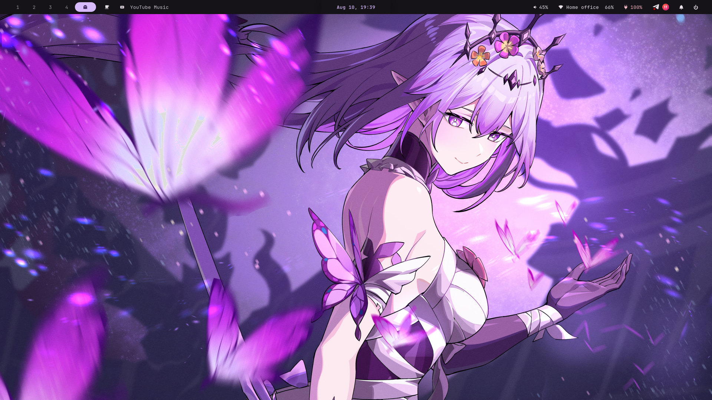

# biomistik-dotfiles

Personal CachyOS + Hyprland dotfiles featuring a custom full-width Waybar,
Material You theming, animated hover menus, media integration and more.

> Snapshot of the live system on 2026-08-10. The running Hyprland configuration
> uses the native Lua provider. The repository is assembled from copies; the
> original files in `$HOME` and `/usr/share` were not moved or symlinked.

## Screenshots



## Overview

The live desktop is CachyOS with Hyprland 0.56+, UWSM and a locally patched
Waybar 0.15.0. The patch adds `on-hover`/`on-hover-lost` events and exposes the
trigger position, allowing the GTK menu surfaces to attach visually to the bar.

Quickshell is part of this rice, but it is used by **HyprQuickPaper**, the
animated wallpaper picker. The currently running top bar is Waybar, not a
Quickshell bar. This distinction reflects the actual processes and configs on
the source machine.

## Features

- Native `hyprland.lua` entrypoint with modular Lua config, animated workspaces,
  window rules, gestures and a US/RU keyboard layout.
- Full-width Material You Waybar with workspace controls and seamless animated
  hover/dropdown surfaces.
- MPRIS source detection, artwork, playback controls and a Cava-powered audio
  visualizer.
- Hover pages for audio mixing, Wi-Fi, battery/power profiles, clock/calendar,
  notifications and session controls.
- Matugen palette generation for Waybar, Hyprland, Hyprlock, Kitty, Rofi, Cava,
  btop and Fastfetch.
- Quickshell HyprQuickPaper selector with directional previews and AWWW
  transitions.
- SwayNC notifications, SwayOSD volume/brightness feedback, clipboard history,
  screenshots and screen recording.
- Custom Rofi launcher, Kitty, Fish, btop and randomized Fastfetch artwork.
- Customized GPL-licensed Sugar Candy SDDM theme with the current Material
  palette and wallpaper.
- A GTK4 language-switch OSD script is preserved in `local/bin`, but the live
  snapshot did not have it running or enabled as a service.

## Requirements

The installer targets CachyOS/Arch Linux and expects `pacman`. It prefers `paru`
and falls back to `yay` for AUR packages. The focused dependency lists are:

- `packages/rice-pacman.txt` — required repository packages and hotkey apps.
- `packages/rice-aur.txt` — Matugen, AWWW, SwayOSD and other AUR components.
- `packages/waybar-build-pacman.txt` — only needed to rebuild patched Waybar.
- `packages/explicit-pacman.txt` and `packages/explicit-aur.txt` — full snapshots
  of explicitly installed packages for reference; `install.sh` does **not**
  install these complete lists.

The bundled patched Waybar is an x86_64 Arch/CachyOS binary. If a future rolling
release changes its shared-library ABI, rebuild it from the saved patch:

```bash
./scripts/build-patched-waybar.sh --install
```

## Installation

Review the actions first:

```bash
git clone https://github.com/biomistik/biomistik-dotfiles.git
cd biomistik-dotfiles
./install.sh --dry-run
```

Install the rice and dependencies:

```bash
./install.sh
```

Useful options:

```bash
./install.sh --no-packages
./install.sh --no-sddm
```

The installer does not use Stow or create symlinks. Before replacing a target,
it moves the existing file/directory to `*.backup-YYYY-MM-DD-HHMMSS`. It uses
`sudo` only for pacman and the SDDM files under `/usr/share` and `/etc`.

Log out and back in after installation so UWSM and Hyprland load the complete
environment. Fish can be made the login shell manually if needed:

```bash
chsh -s /usr/bin/fish
```

## Manual installation

Each directory under `config/` maps to `$HOME/.config/<name>`. `local/` maps to
`$HOME/.local`, `systemd/user/` maps to `$HOME/.config/systemd/user`, and
`wallpapers/` maps to `$HOME/Pictures/Wallpapers`.

After a manual systemd install:

```bash
systemctl --user daemon-reload
systemctl --user enable --now waybar-media-source.service \
  waybar-panel-menu.service noctra-sddm-colors.path
```

The SDDM theme maps to `/usr/share/sddm/themes/noctra-material`; the selection
file maps to `/etc/sddm.conf.d/10-noctra-theme.conf`.

## Keybindings

| Keys | Action |
| --- | --- |
| `Super + T` | Kitty |
| `Super + E` | Thunar |
| `Super + W` | Zen Browser |
| `Super + A` or release `Super` | Rofi application launcher |
| `Ctrl + Shift + Esc` | btop in Kitty |
| `Super + Q` | Close focused window |
| `Super + F` | Fullscreen |
| `Super + Alt + F` | Maximize while keeping bar/gaps |
| `Super + Alt + Space` | Toggle floating |
| `Super + Arrow` | Move focus |
| `Super + Shift + Arrow` | Move window |
| `Super + 1..0` | Switch workspace 1–10 |
| `Super + Alt + 1..0` | Move focused window to workspace |
| `Super + Shift + 1..0` | Move the window under the cursor without following |
| `Super + N` | Toggle SwayNC |
| `Super + Esc` / `Ctrl + Alt + Del` | Session/power menu |
| `Super + L` | Lock |
| `Print` | Full screenshot |
| `Super + Shift + S` | Area screenshot |
| `Ctrl + Alt + R` | Start/stop full-screen recording |
| `Super + Shift + Alt + R` | Area recording |
| `Super + V` | Clipboard history |
| `Super + .` | Emoji picker |
| `Super + Shift + C` | Color picker and copy |
| `Super + Shift + W` | Quickshell wallpaper picker |
| `Alt + Shift` | Toggle English/Russian keyboard layout |

Media and laptop multimedia keys are also mapped through Playerctl and SwayOSD.

## Project structure

```text
config/                 User application configs
  hypr/                 Active Lua provider plus Hyprlang fallback files
  quickshell/           HyprQuickPaper wallpaper picker
  waybar/               Bar config, GTK hover menu and MPRIS services
local/                  User scripts, custom cursor and patched Waybar binary
systemd/user/            Rice user services and SDDM color watcher
sddm/noctra-material/    Customized Sugar Candy theme
wallpapers/              Wallpaper library used by AWWW/Matugen
patches/waybar/           Rebuildable hover-event patch
packages/                Focused dependencies and package snapshots
scripts/                 Backup, secret scan and Waybar rebuild helpers
screenshots/             Sanitized desktop screenshot
```

## Customization and hardware notes

- `config/hypr/monitors.lua` and `monitors.conf` target the source laptop panel
  `eDP-1` at `1920x1080@60`. Change both files for another monitor layout.
- `sddm/noctra-material/theme.conf.user` also records a 1920×1080 canvas.
- The UWSM environment contains AMD Mesa variables copied from the Ryzen/Vega
  source laptop. Review them on Intel or NVIDIA hardware.
- Hyprland 0.55+ prefers `hyprland.lua` when it exists. The `.conf` files are
  preserved as fallback/reference, but they are not the active provider in this
  snapshot.
- The source config contains a stale autostart reference to
  `~/.config/hypr/scripts/matugen-watcher.sh`; no such file existed on the live
  machine. Wallpaper changes still run Matugen directly through
  HyprQuickPaper's `commands.sh`.

## Backup and restore

Create an independent snapshot of the currently installed rice:

```bash
./scripts/backup.sh --dry-run
./scripts/backup.sh
```

Backups are written under `$HOME/dotfiles-backups/`. To remove the installed
copy without deleting it:

```bash
./uninstall.sh --dry-run
./uninstall.sh
```

To restore the newest adjacent backups created by `install.sh`:

```bash
./uninstall.sh --restore-latest
```

Add `--with-sddm` if the SDDM theme/config should also be removed or restored.
All uninstall operations are recoverable moves to `*.removed-TIMESTAMP`.

## Security and publishing

Run the repository scanner before every commit:

```bash
./scripts/secret-scan.sh
./scripts/secret-scan.sh --staged
```

No SSH/GPG keys, keyrings, Wi-Fi credentials, browser profiles, messaging data,
caches or session databases belong here. The repository intentionally includes
personal-use third-party artwork with unclear redistribution terms. Read
[`THIRD_PARTY_NOTICES.md`](THIRD_PARTY_NOTICES.md) and replace or remove those
assets before changing the GitHub repository from private to public.

## Credits and inspiration

- [Caelestia Shell](https://github.com/caelestia-dots/shell) inspired parts of
  the keybinding/workflow style; this rice is not a Caelestia fork.
- [HyprQuickPaper](https://github.com/iamsurjog/hyprquickpaper) provides the
  Quickshell wallpaper picker base. Its upstream README credits
  [Ilyamiro's dotfiles](https://github.com/ilyamiro/nixos-configuration) as
  inspiration; the desktop shell in this repository is not an Ilyamiro fork.
- [Sugar Candy](https://framagit.org/MarianArlt/sddm-sugar-candy) by Marian Arlt
  is the GPL-licensed base of the SDDM theme.
- [Waybar](https://github.com/Alexays/Waybar) is the MIT-licensed base for the
  locally patched bar binary.

## License

Biomistik's original configuration and scripts are MIT-licensed. Third-party
components and artwork retain their own terms; see
[`THIRD_PARTY_NOTICES.md`](THIRD_PARTY_NOTICES.md).
